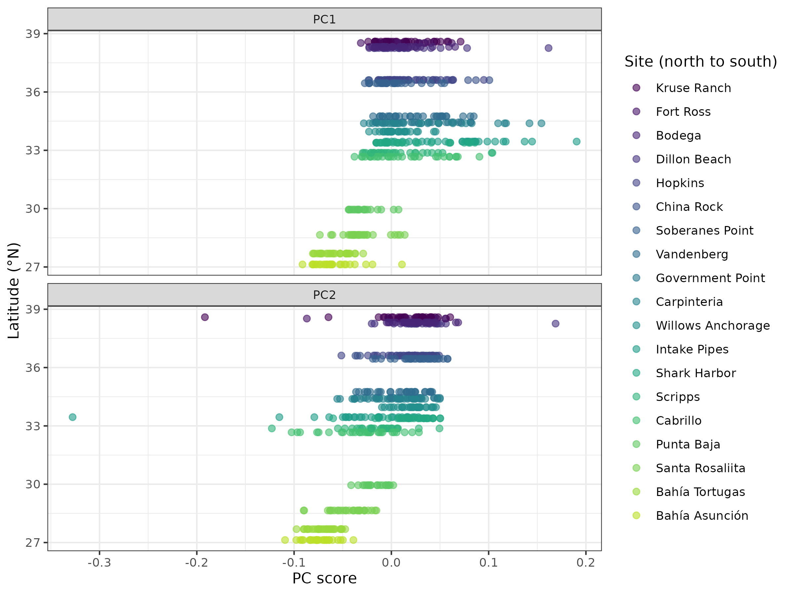
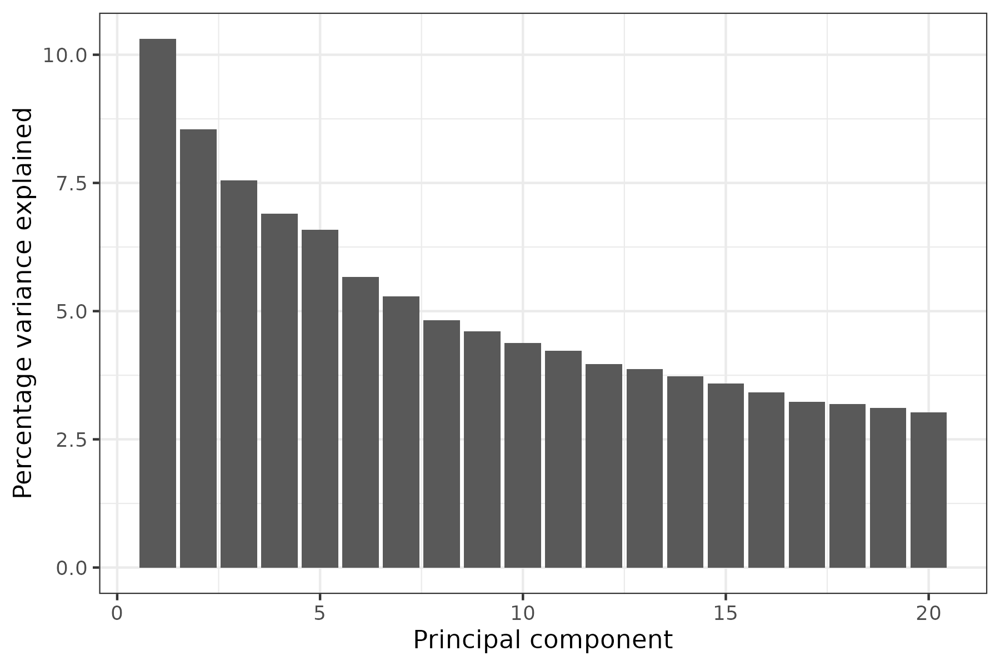
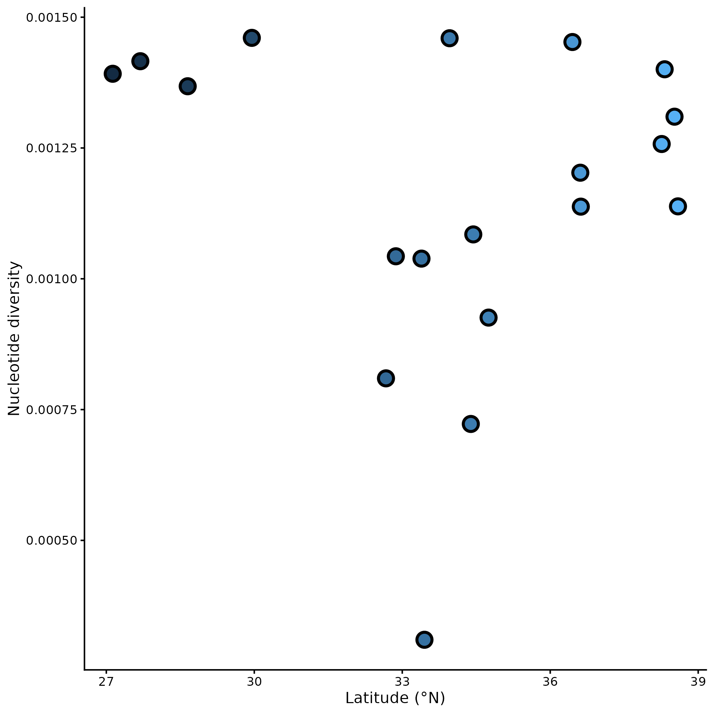
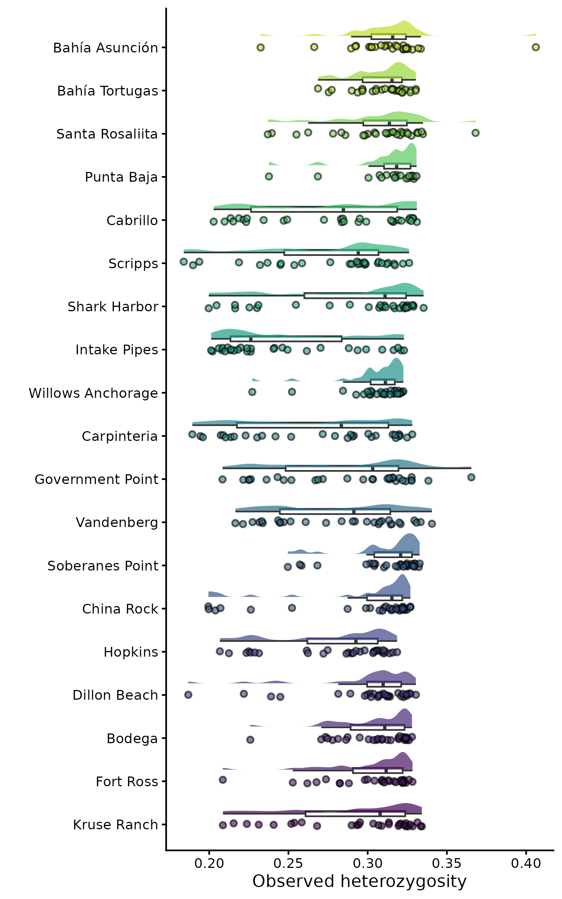

# Population Genomics Notebook

**Course:** Intro to Ecological Genomics - Fall 2026

**Name:** Emma Shaw

------------------------------------------------------------------------

## 10.13.2026 - Popgen Day 2

-   Intro to study system Lottia gigantea
-   learned basic bash commands for navigating vcf files

**Working Directory:**

`/gpfs1/home/e/s/eshaw7/projects/eco_genomics__2026/population_genomics`

**Input Files:**

`none`

**Output Files:**

`none`

**Programs and dependencies**:

-   `R version 4.5.1`

-   `R-Studio`

**Scripts:**

`none`

**Code:**

```         
# Load many modules with gcc dependencies
module load gcc
module load module_name

# view bfctools resions and record the versions you use in your methods
bcftools --version   

# access bcftools manual
bcftools -h        

# grep (global regular expression print) grabs and prints lines that #match pattern
# -v inverts the command and prints the opposite 
bcftools head file_name.vcf.gz | grep -v "##contig="

# see how the file was made and what each field means
bcftools view -h file_name.vcf.gz | grep "^##INFO"
bcftools view -h file_name.vcf.gz | grep "^##FORMAT"


# bcftools also writes every command it runs into the header (in lines containing
# Command=), so you can often reconstruct how a file was made and filtered:
bcftools view file_name.vcf.gz | grep "Command="

# The VCF also stores our sample names, which we can list with bcftools query -l:
bcftools query -l Lottia_gigantea_pl_flt3.renamed.vcf.gz

# count the samples by piping into wc -l (counts lines)
bcftools query -l file_name.vcf.gz | wc -l
```

------------------------------------------------------------------------

## 10.15.2026 - Popgen Day 2

-   learned how to submit sbatch job

**Working Directory:**

`/gpfs1/home/e/s/eshaw7/projects/eco_genomics__2026/population_genomics`

**Input Files:**

`Lottia_gigantea_pl_flt3.renamed.vcf.gz`

**Output Directory:**

`/gpfs1/home/e/s/eshaw7/projects/eco_genomics__2026/population_genomics/myresults/missing_data`

`/gpfs1/home/e/s/eshaw7/projects/eco_genomics__2026/population_genomics/myresults/depth_data`

**Programs and dependencies**:

-   `R version 4.5.1`

-   `R-Studio`

**Scripts:**

`vcf_stats.sh`

**Code:**

```         
#!/bin/bash
#SBATCH --job-name=vcf_stats
#SBATCH --partition=general
#SBATCH --nodes=1
#SBATCH --cpus-per-task=1
#SBATCH --mem=40G
#SBATCH --time=30:00:00
#SBATCH --output=./logs/%x.%j.out
#SBATCH --error=./logs/%x.%j.err
#SBATCH --mail-type=ALL
#SBATCH --mail-user=eshaw7@uvm.edu

module load gcc
module load vcftools

##set your path to where the data is, change to your own path!!
INDIR="/gpfs1/home/e/s/eshaw7/projects/eco_genomics__2026/population_genomics/mydata"
##set your path to where the data will be stored, change to your own path!!
OUTDIR="/gpfs1/home/e/s/eshaw7/projects/eco_genomics__2026/population_genomics/myresults"

##change to directory where data is
cd $INDIR
##change out directory to where the results will go
vcftools --gzvcf Lottia_gigantea_pl_flt3.renamed.vcf.gz --missing-indv --out $OUTDIR/missing_data
vcftools --gzvcf Lottia_gigantea_pl_flt3.renamed.vcf.gz --depth --out $OUTDIR/depth_data
```

------------------------------------------------------------------------

## 10.20.2026 - Popgen Day 3

-   made admixture plot

-   visualized data with pca

    -   made latitude pca

    -   made map pca

-   visualized variance explained by different principal components with variance graph

**Working Directory:**

`/gpfs1/home/e/s/eshaw7/projects/eco_genomics__2026/population_genomics`

**Input Files:**

`Lottia_gigantea_pl_flt3.renamed.vcf.gz`

**Output Directory:**

`/gpfs1/home/e/s/eshaw7/projects/eco_genomics__2026/population_genomics/myresults/missing_data`

`/gpfs1/home/e/s/eshaw7/projects/eco_genomics__2026/population_genomics/myresults/depth_data`

**Programs and dependencies**:

-   `R version 4.5.1`

-   `R-Studio`

**Scripts:**

`mypcajob.sh`

**Code:**

```         
# Run a SLURM job to create a PCA for genetic variant data

#!/bin/bash
#SBATCH --job-name=pca
#SBATCH --partition=general
#SBATCH --nodes=1
#SBATCH --cpus-per-task=1
#SBATCH --mem=32G
#SBATCH --time=8:00:00
#SBATCH --output=./logs/%x.%j.out
#SBATCH --error=./logs/%x.%j.err
#SBATCH --mail-type=END
#SBATCH --mail-user=eshaw7@uvm.edu

cd /users/e/s/eshaw7/projects/eco_genomics__2026/population_genomics/mydata

OUTDIR=/users/e/s/eshaw7/projects/eco_genomics__2026/population_genomics/myresults

VCF=Lottia_gigantea_pl_flt3.renamed.vcf.gz

echo $VCF

module load plink

plink --vcf $VCF --double-id --allow-extra-chr \
    --set-missing-var-ids @:# \
    --indep-pairwise 50 10 0.2 \
    --out $OUTDIR/Lg_LD_0.2_alldata

plink --vcf $VCF --double-id --allow-extra-chr --set-missing-var-ids @:# \
    --extract $OUTDIR/Lg_LD_0.2.prune.in \
    --make-bed --pca --out $OUTDIR/ Lg_LD_0.2_alldata

echo "my script is done!"
```

**images:**







------------------------------------------------------------------------

## 10.22.2026 - Popgen Day 4

-   **Genetic Diversity Can be Measured in:**

    -   heterozygosity

    -   private alleles

    -   Fst

    -   Nucleotide Diversity

    -   Inbreeding coefficient

-   **Hardy Weinberg Equilibrium**

    -   p^2^ +2pq +q^2^ =1

-   **Indbreeding Ceefficient**

    -   Ho= heterozygous individuals

    -   He= total individuals

    -   F=1-Ho/He

-   **Tajima's D**

    -   used to detect selection

    -   greater than 0 is a signature of balancing selection

    -   less than 0 shows a selective sweep

**Working Directory:**

`/gpfs1/home/e/s/eshaw7/projects/eco_genomics__2026/population_genomics`

**Input Files:**

`Lottia_gigantea_pl_flt3.renamed.vcf.gz`

**Output Directory:**

`none`

**Programs and dependencies**:

-   `R version 4.5.1`

-   `R-Studio`

**Scripts:**

`none`

**Code:**

`none`

------------------------------------------------------------------------

## 10.27.2026 - Popgen Day 5

-   we would expect alleles to fix at sites if they didnt have didfferent values in different environments.

-   negative tajd = positive selection

-   negative selection (stabilizing)= positive tajd

-   inbreeding coeeficient

    -   negative is not inbred

    -   positive is inbred

**Working Directory:**

`/gpfs1/home/e/s/eshaw7/projects/eco_genomics__2026/population_genomics`

**Input Files:**

`Lottia_gigantea_pl_flt3.renamed.vcf.gz`

**Output Directory:**

`none`

**Programs and dependencies**:

-   `R version 4.5.1`

-   `R-Studio`

**Scripts:**

`none`

**Code:**

`none`

**Images:**






